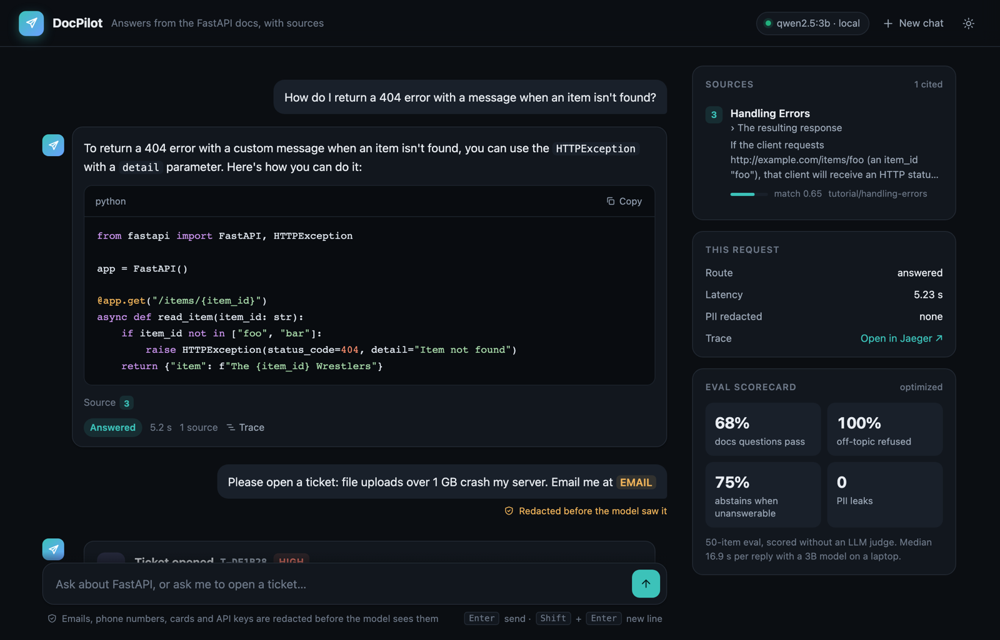
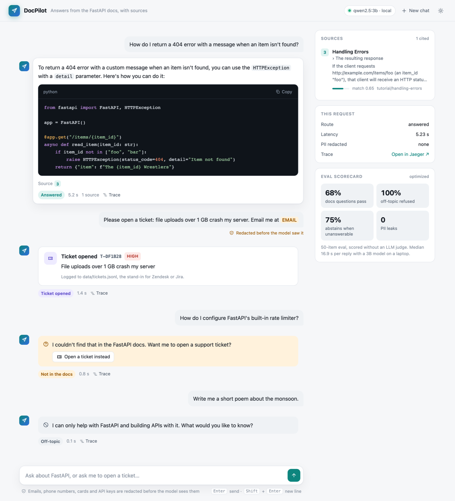
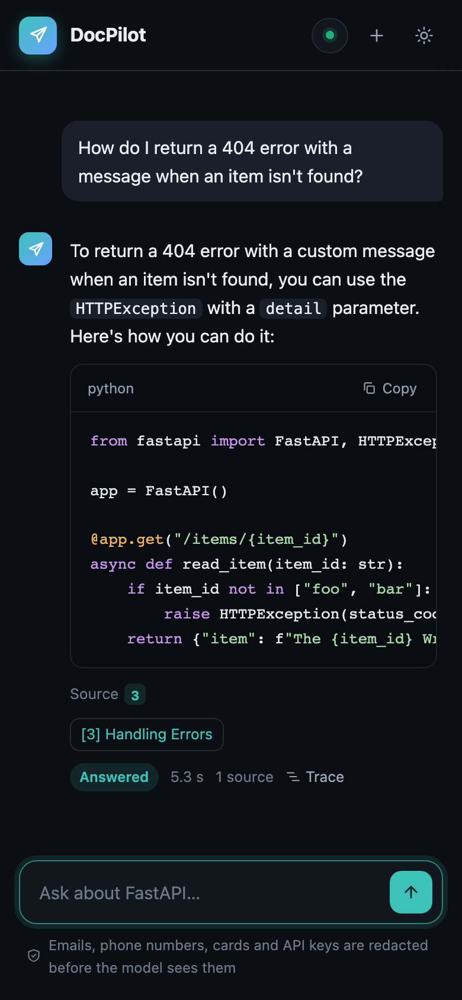
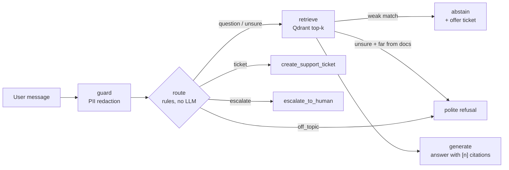

# DocPilot

**A support agent that answers from your docs with citations, says "I don't know" when it should, opens tickets, and
proves its quality with an eval suite.** This demo is built over the [FastAPI documentation](https://fastapi.tiangolo.com)
and runs fully local: Qwen2.5 via Ollama, Qdrant, no API keys.



## Scorecard

The `optimized` preset on the 50-item eval set, with Qwen2.5 3B running locally on an 8 GB M1:

| | |
|---|---|
| Overall pass rate | **74%** (37 of 50) |
| Docs questions answered correctly | 68% (26 of 38): cited the expected page and covered the key facts |
| Expected page retrieved (top 4) | 95% |
| Cites a source / citation points at the right page | 97% / 82% |
| Abstains on unanswerable questions | 75% (3 of 4) |
| Refuses off-topic requests | 100% (4 of 4) |
| Opens the ticket or escalates when asked | 100% (4 of 4) |
| PII leaked into answers or tickets | **0** |
| Latency, median / p95 | 16.9 s / 29.3 s (3B model on a laptop) |
| LLM calls / input tokens per query | 0.88 / 642 |

Most misses are answers that leave out an expected key fact. Every answer, route and citation is in
`results/optimized.json`. The numbers come from a small local model; a hosted model would score higher and answer in a
second or two. The point of the eval is that you can measure that instead of guessing.

## The UI

A single static page served by the API, with no build step and no external requests:

- Answers render markdown with syntax-highlighted code and copy buttons. Citations are inline chips linked to the
  **sources panel**, which shows each docs section's title, a plain-text snippet, the retrieval match score and a deep link.
- Redacted PII is shown in the user's own message, so you can see exactly what the model received.
- Abstentions offer a one-click ticket. Tickets and escalations render as cards with their reference.
- Each reply shows its route, latency and a link to its trace. The sidebar shows the latest eval scorecard from
  `/api/scorecard`.
- Light and dark themes, and it works on a phone.

| Light theme | Phone |
|---|---|
|  |  |

## How it works



- **Retrieval:** 114 docs pages are split by heading into 1,219 chunks and embedded with `nomic-embed-text` into Qdrant.
  Every chunk keeps its page, heading and a deep link, so citations point at the exact section.
- **Grounded answers:** the model may only use the numbered sources. Citations are parsed and validated: a `[7]` that
  doesn't match a retrieved source is dropped, and a "not in the sources" answer becomes an explicit abstention.
- **Guardrails before the model:** emails, phone numbers (Indian and US formats), card numbers, Aadhaar numbers and API keys
  are replaced with placeholders before any model, trace or ticket sees them.
- **Routing without an extra LLM call:** obvious intents ("open a ticket", "talk to a human", FastAPI terms) are matched
  by rules. Anything else is retrieved first. If it isn't close to any docs chunk (top cosine score below 0.62), it's
  treated as off-topic and politely refused. A 1.5B router model was tried first and rejected, because the eval showed
  it mislabelled off-topic messages ([details](https://github.com/FardeenK29/agent-cost-teardown)).
- **Tools:** `create_support_ticket` (the LLM fills summary and severity) and `escalate_to_human`. Both write to a JSONL
  file that stands in for Zendesk or Jira.
- **Tracing:** every request is traced with [AgentLens](https://github.com/FardeenK29/agentlens) (OpenTelemetry). The chat
  UI links each answer to its trace in Jaeger.

## Evaluation

`evals/dataset.jsonl` holds 50 hand-written items:

| Kind | # | Passes when |
|---|---|---|
| Docs questions | 38 | Answered, cites the expected docs page, mentions ≥ 50% of the key facts |
| Unanswerable (in-domain) | 4 | Abstains, e.g. "FastAPI's built-in rate limiter" (there isn't one) |
| Off-topic | 4 | Refuses |
| Ticket / escalation | 4 | Takes the right action; two of them contain PII that must not leak |

Scoring is deterministic, with no LLM judge. Every key fact was checked against the expected page by
`evals/build_dataset.py`, so the answer key is grounded in the docs. Efficiency (tokens, LLM calls, latency) comes from
the AgentLens spans of each run.

```bash
python -m evals.run_eval --preset optimized     # writes results/optimized.json
evals/run_all.sh                                # every teardown preset, then results/comparison.md
```

The cost and latency work that produced the `optimized` preset is written up in
[agent-cost-teardown](https://github.com/FardeenK29/agent-cost-teardown).

## Run it

Prerequisites: Python 3.10+, [Ollama](https://ollama.com), and optionally Docker for the tracing stack.

```bash
git clone https://github.com/FardeenK29/docpilot && cd docpilot
python -m venv .venv && source .venv/bin/activate && pip install -e ".[dev]"
ollama pull qwen2.5:3b && ollama pull nomic-embed-text
./scripts/fetch_docs.sh                 # FastAPI docs (MIT), docs folder only
python -m docpilot.ingest               # ~2 min on an M1
uvicorn docpilot.api:app --port 8000    # chat UI at http://localhost:8000
```

For traces, start the [AgentLens stack](https://github.com/FardeenK29/agentlens) (`docker compose up -d`). The "view trace"
link under each answer opens it in Jaeger.

API:

```bash
curl -s localhost:8000/api/chat -H 'content-type: application/json' \
  -d '{"message": "How do I add CORS to my app?"}' | jq
```

Returns `answer`, `route` (`answered | abstained | refused | ticket | escalated`), `citations[]` (title, heading, url,
snippet, score), `ticket`, `redacted[]`, `redacted_message`, `latency_ms` and `trace_url`. `GET /api/scorecard` returns
the latest eval summary for the active preset.

## Swapping in your own docs or model

- **Docs:** point `docpilot/ingest.py` at any Markdown folder (adjust `SECTIONS` and `page_url`).
- **Model:** the chat model is a plain LangChain chat model. Swap `ChatOllama` for `ChatOpenAI`,
  `ChatAnthropic` or Bedrock in `graph.py`, and the rest (tracing, evals) works unchanged.

## Tests

```bash
pytest   # redaction, rule router, citation parsing, snippets (no model needed)
```

## License

MIT. The FastAPI documentation is © Sebastián Ramírez, MIT licensed, and is fetched at setup, not redistributed.
